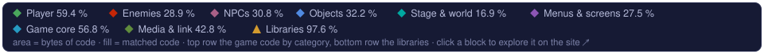
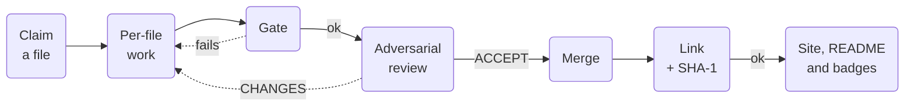

<p align="center">
  <a href="https://sh1ftmaker.github.io/fsa/">
    
  </a>
</p>

<p align="center">
  <a href="https://sh1ftmaker.github.io/fsa/"></a>
  <a href="https://sh1ftmaker.github.io/fsa/"></a>
  <a href="https://sh1ftmaker.github.io/fsa/"></a>
  <a href="https://sh1ftmaker.github.io/fsa/"></a>
  <a href="https://github.com/sh1ftmaker/fsa/actions/workflows/pages.yml"></a>
</p>

<p align="center">
  A byte-matching decompilation of <i>The Legend of Zelda: Four Swords Adventures</i> for the GameCube.
</p>

<p align="center">
  <a href="https://sh1ftmaker.github.io/fsa/"><b>Progress site</b></a>
  &nbsp;·&nbsp;
  <a href="#progress"><b>Progress</b></a>
  &nbsp;·&nbsp;
  <a href="#roadmap"><b>Roadmap</b></a>
  &nbsp;·&nbsp;
  <a href="CONTRIBUTING.md"><b>Contributing</b></a>
  &nbsp;·&nbsp;
  <a href="docs/PLAN.md"><b>Plan</b></a>
</p>

<!-- treemap:start -->
<p align="center">
<a href="https://sh1ftmaker.github.io/fsa/#/game/game-boot" title="Boot to main menu: 19.3 % of 1,258,252 bytes matched, 1,428 / 2,394 functions. Open it on the progress site."></a><a href="https://sh1ftmaker.github.io/fsa/#/game/game-battle" title="Main menu to Shadow Battle: 20.4 % of 644,344 bytes matched, 785 / 1,336 functions. Open it on the progress site."></a><a href="https://sh1ftmaker.github.io/fsa/#/game/game-actors" title="Actors: 27.3 % of 1,027,824 bytes matched, 1,086 / 1,962 functions. Open it on the progress site."></a><a href="https://sh1ftmaker.github.io/fsa/#/game/game-other" title="Everything else: 22.4 % of 643,364 bytes matched, 560 / 1,097 functions. Open it on the progress site."></a><br>
<a href="https://sh1ftmaker.github.io/fsa/#/jsystem" title="JSystem: 97.9 % of 630,852 bytes matched, 3,650 / 3,702 functions. Open it on the progress site."></a><a href="https://sh1ftmaker.github.io/fsa/#/sdk" title="Dolphin SDK: 100 % of 131,224 bytes matched, 610 / 610 functions. Open it on the progress site."></a><a href="https://sh1ftmaker.github.io/fsa/#/runtime" title="MSL, Runtime, TRK: 90.0 % of 72,512 bytes matched, 281 / 284 functions. Open it on the progress site."></a><a href="https://sh1ftmaker.github.io/fsa/#/gx" title="GX: 100 % of 33,660 bytes matched, 172 / 172 functions. Open it on the progress site."></a><br>
<a href="https://sh1ftmaker.github.io/fsa/#treemap" title="Open the interactive treemap"></a>
</p>
<!-- treemap:end -->

<p align="center"><sub>The whole DOL: area is bytes of code, the fill is the share byte-identical. The top row is the
game code in its four parts, the bottom row the libraries. Click a block to open it in the
<a href="https://sh1ftmaker.github.io/fsa/#treemap">interactive treemap</a>, which goes down to single functions.</sub></p>

---

## Progress

<!-- progress:start -->
As of 2026-11-05:

- **Honest: 37.06 %** of the code is byte-identical, **8,572 / 11,557** functions (1,646,088 of 4,442,032 bytes; 100 % functions only).
- **Weighted: 43.49 %**, the honest bytes plus partial credit for structurally matched functions (a separate, secondary measure).
- **Structurally matched:** 8,993 / 11,557 functions (same instructions, register or order differences only), +106 close.
- **449 of 902** split units are Matching, and `main.dol` built from them links byte-identically (SHA-1 OK).
<!-- progress:end -->

<picture>
  <source media="(prefers-color-scheme: dark)" srcset="site/badges/regions-dark.svg">
  <source media="(prefers-color-scheme: light)" srcset="site/badges/regions-light.svg">
  
</picture>

### Libraries

The Dolphin SDK, GX, JSystem, and MSL, Runtime and MetroTRK: imported from
other decompilations and finished file by file. What is left is a few dozen
holdouts.

<!-- libraries:start -->
**97.6 %** of 868,248 bytes of library code and **4,713 / 4,768** functions match (weighted 98.6 %).

| Library | Code matched | Functions | Left |
|---|--:|--:|--:|
| [Dolphin SDK](https://sh1ftmaker.github.io/fsa/#/sdk) | 100 % of 131,224 bytes | 610 / 610 | – |
| [GX](https://sh1ftmaker.github.io/fsa/#/gx) | 100 % of 33,660 bytes | 172 / 172 | – |
| [JSystem](https://sh1ftmaker.github.io/fsa/#/jsystem) | 97.9 % of 630,852 bytes | 3,650 / 3,702 | 52 |
| [MSL, Runtime, TRK](https://sh1ftmaker.github.io/fsa/#/runtime) | 90.0 % of 72,512 bytes | 281 / 284 | 3 |

<details><summary>Every library</summary>

<details><summary>Dolphin SDK: 18 libraries</summary>

| Library | Code matched | Functions |
|---|--:|--:|
| [os](https://sh1ftmaker.github.io/fsa/#/sdk/sdk-os) | 100 % of 29,664 bytes | 175 / 175 |
| [card](https://sh1ftmaker.github.io/fsa/#/sdk/sdk-card) | 100 % of 25,944 bytes | 84 / 84 |
| [dvd](https://sh1ftmaker.github.io/fsa/#/sdk/sdk-dvd) | 100 % of 17,796 bytes | 90 / 90 |
| [exi](https://sh1ftmaker.github.io/fsa/#/sdk/sdk-exi) | 100 % of 8,112 bytes | 27 / 27 |
| [ar](https://sh1ftmaker.github.io/fsa/#/sdk/sdk-ar) | 100 % of 7,900 bytes | 15 / 15 |
| [pad](https://sh1ftmaker.github.io/fsa/#/sdk/sdk-pad) | 100 % of 7,860 bytes | 24 / 24 |
| [vi](https://sh1ftmaker.github.io/fsa/#/sdk/sdk-vi) | 100 % of 7,780 bytes | 24 / 24 |
| [gba](https://sh1ftmaker.github.io/fsa/#/sdk/sdk-gba) | 100 % of 7,160 bytes | 35 / 35 |
| [si](https://sh1ftmaker.github.io/fsa/#/sdk/sdk-si) | 100 % of 6,504 bytes | 26 / 26 |
| [gd](https://sh1ftmaker.github.io/fsa/#/sdk/sdk-gd) | 100 % of 2,940 bytes | 7 / 7 |
| [OdemuExi2](https://sh1ftmaker.github.io/fsa/#/sdk/sdk-odemuexi2) | 100 % of 2,688 bytes | 14 / 14 |
| [mtx](https://sh1ftmaker.github.io/fsa/#/sdk/sdk-mtx) | 100 % of 2,496 bytes | 23 / 23 |
| [ai](https://sh1ftmaker.github.io/fsa/#/sdk/sdk-ai) | 100 % of 2,276 bytes | 19 / 19 |
| [dsp](https://sh1ftmaker.github.io/fsa/#/sdk/sdk-dsp) | 100 % of 1,536 bytes | 11 / 11 |
| [base](https://sh1ftmaker.github.io/fsa/#/sdk/sdk-base) | 100 % of 276 bytes | 22 / 22 |
| [db](https://sh1ftmaker.github.io/fsa/#/sdk/sdk-db) | 100 % of 236 bytes | 5 / 5 |
| [amcstubs](https://sh1ftmaker.github.io/fsa/#/sdk/sdk-amcstubs) | 100 % of 48 bytes | 8 / 8 |
| [odenotstub](https://sh1ftmaker.github.io/fsa/#/sdk/sdk-odenotstub) | 100 % of 8 bytes | 1 / 1 |

</details>

<details><summary>JSystem: 12 libraries</summary>

| Library | Code matched | Functions |
|---|--:|--:|
| [J3D](https://sh1ftmaker.github.io/fsa/#/jsystem/jsystem-j3d) | 98.2 % of 173,328 bytes | 1,166 / 1,191 |
| [J2DGraph](https://sh1ftmaker.github.io/fsa/#/jsystem/jsystem-j2dgraph) | 97.1 % of 159,196 bytes | 878 / 887 |
| [JAudio](https://sh1ftmaker.github.io/fsa/#/jsystem/jsystem-jaudio) | 96.7 % of 120,700 bytes | 747 / 755 |
| [JKernel](https://sh1ftmaker.github.io/fsa/#/jsystem/jsystem-jkernel) | 98.8 % of 55,724 bytes | 324 / 327 |
| [JParticle](https://sh1ftmaker.github.io/fsa/#/jsystem/jsystem-jparticle) | 98.7 % of 54,360 bytes | 200 / 202 |
| [JUtility](https://sh1ftmaker.github.io/fsa/#/jsystem/jsystem-jutility) | 100 % of 47,044 bytes | 190 / 190 |
| [JMessage](https://sh1ftmaker.github.io/fsa/#/jsystem/jsystem-jmessage) | 100 % of 7,936 bytes | 79 / 79 |
| [JFramework](https://sh1ftmaker.github.io/fsa/#/jsystem/jsystem-jframework) | 100 % of 7,092 bytes | 21 / 21 |
| [JSupport](https://sh1ftmaker.github.io/fsa/#/jsystem/jsystem-jsupport) | 100 % of 3,264 bytes | 29 / 29 |
| [JMath](https://sh1ftmaker.github.io/fsa/#/jsystem/jsystem-jmath) | 96.5 % of 1,256 bytes | 6 / 7 |
| [JGadget](https://sh1ftmaker.github.io/fsa/#/jsystem/jsystem-jgadget) | 100 % of 936 bytes | 10 / 10 |
| [JStudio\_JParticle](https://sh1ftmaker.github.io/fsa/#/jsystem/jsystem-jstudio-jparticle) | 0 % of 16 bytes | 0 / 4 |

</details>

<details><summary>MSL, Runtime, TRK: 3 libraries</summary>

| Library | Code matched | Functions |
|---|--:|--:|
| [MSL\_C](https://sh1ftmaker.github.io/fsa/#/runtime/runtime-msl-c) | 79.4 % of 35,380 bytes | 83 / 86 |
| [MetroTRK](https://sh1ftmaker.github.io/fsa/#/runtime/runtime-metrotrk) | 100 % of 33,288 bytes | 165 / 165 |
| [Runtime](https://sh1ftmaker.github.io/fsa/#/runtime/runtime-runtime) | 100 % of 3,844 bytes | 33 / 33 |

</details>

</details>
<!-- libraries:end -->

### Game code

FSA's own code is most of what remains. It is cut into four parts: the two
stretches of the [boot path](docs/BOOT_PATH.md) (every file the game runs
from power-on to the main menu, then on to a live Shadow Battle, measured in
Dolphin), then the actors and everything else. This is also the order the
work goes in.

<!-- game:start -->
**22.3 %** of 3,573,784 bytes of game code and **3,859 / 6,789** functions match (weighted 30.1 %).

| Part | Code matched | Weighted | Functions | Files Matching |
|---|--:|--:|--:|--:|
| [Boot to main menu](https://sh1ftmaker.github.io/fsa/#/game/game-boot) | 19.3 % of 1,258,252 bytes | 26.6 % | 1,428 / 2,394 | 6 / 83 |
| [Main menu to Shadow Battle](https://sh1ftmaker.github.io/fsa/#/game/game-battle) | 20.4 % of 644,344 bytes | 32.9 % | 785 / 1,336 | 8 / 60 |
| [Actors](https://sh1ftmaker.github.io/fsa/#/game/game-actors) | 27.3 % of 1,027,824 bytes | 33.9 % | 1,086 / 1,962 | 64 / 264 |
| [Everything else](https://sh1ftmaker.github.io/fsa/#/game/game-other) | 22.4 % of 643,364 bytes | 28.0 % | 560 / 1,097 | 27 / 121 |

- **Boot to main menu:** Code the game runs from power-on to the main menu: main(), the framework, the THP movie player, the title screen and the screens built at boot, such as file select, the game mode screen and the GBA link (boot path phases 1 and 2).
- **Main menu to Shadow Battle:** Code first run between the main menu and a live Shadow Battle: stage load, the players, the field and the actors on it (boot path phase 3).
- **Actors:** Enemies, NPCs and objects not on the boot path: act\_\* files and files whose classes the actor spawner builds.
- **Everything else:** Systems, screens, minigames and still-unidentified tu\_\* files that the boot path does not reach.
<!-- game:end -->

All figures come from the honest objdiff report
(`build/G4SE01/report_honest.json`): every unit is diffed, and a function
counts only if its relocations point at the same symbols too. The weighted
figure is shown separately and never mixed into the honest one. They are
regenerated with every merge; see [How it works](#how-it-works).

## Roadmap

<picture>
  <source media="(prefers-color-scheme: dark)" srcset="site/badges/roadmap-dark.svg">
  <source media="(prefers-color-scheme: light)" srcset="site/badges/roadmap-light.svg">
  
</picture>

<!-- now:start -->
- **Now** (phase 2): **Library holdouts.** About fifty JSystem functions that resist (register allocation and J3DMatBlock's word copies, kept honest with FIXMEs) and MSL's ansi_fp and strtoul. Most go to the crack pass. Currently 98.6 % of the functions matched.
- **Now** (phase 3): **Waves of small-function units.** One agent per file, one reviewer per wave. Actor waves, the ActorManager spawner (tu_801F9484, 322 functions) and many small units are merged; recurring shapes are in the rules card. Currently 56.8 % of the functions matched.
- **Now** (phase 3): **Big functions, structure first.** Write a big function before it reaches 100 %, merge it when it is structurally done or close, so the literal pool, field offsets and callee names settle (docs/RULES_CARD.md). Just started on the file select, game mode screen and GBA link units.
- **Now** (phase 4): **Boot to main menu.** main(), the framework, the THP movie player (162 of 168 functions), the title screen and the screens built at boot (file select, the game mode screen, the GBA link manager). Currently 19.3 % of the code matched.
- **Now** (phase 4): **Main menu to Shadow Battle.** Stage load, the players, the field and the actors on it, up to two Links fighting on The Field. Currently 20.4 % of the code matched.
- **Next** (phase 4): **Screens and menus.** The remaining screens, HUD and menus, after their boot-path owners are written.
- **Next** (phase 4): **Actors by family.** Enemies, NPCs and objects family by family, sharing base classes and headers. The earlier actor waves matched the small ones; most update and init functions are still ahead. Currently 27.3 % of the code matched.
- **Next** (phase 4): **The player.** The Link class and the per-player queries, after the boot path has fixed its layout.
- **Next** (phase 4): **Map and stage.** Rooms, collision, background rewrites and the stage loader.
<!-- now:end -->

The phases and milestones are defined in [`docs/roadmap.yml`](docs/roadmap.yml);
[`docs/PLAN.md`](docs/PLAN.md) and [`docs/GAME_PLAN.md`](docs/GAME_PLAN.md)
explain the reasoning behind them.

## About

This repository reconstructs the C and C++ source of *Four Swords Adventures*
(USA). The original Metrowerks CodeWarrior compilers build it back into a
`main.dol` that is identical, byte for byte, to the retail one. Readable,
correctly typed source with real names is part of the goal, in the style of
zeldaret/tp and KATAM.

| Property | Value |
|---|---|
| Game | The Legend of Zelda: Four Swords Adventures |
| Platform | Nintendo GameCube |
| Version | USA, `G4SE01` |
| `main.dol` SHA-1 | `d86b3d9f785566e34264035e140ef3daf3cc19f0` |
| Compilers | Metrowerks CodeWarrior GC/2.6 (game, JSystem, MSL, TRK); the SDK's own builds |
| Build system | ninja + [decomp-toolkit](https://github.com/encounter/decomp-toolkit) + [objdiff](https://github.com/encounter/objdiff) |

## How it works

Each source file is worked on by one owner in its own branch and worktree.
Nothing reaches `matching` without passing the gate and an independent review,
and every merge relinks `main.dol` and checks its SHA-1.



<details>
<summary>What each step checks</summary>

- **Gate** (`tools/gate.py`): no inline asm, register binding, `#pragma` or
  `goto` the donor file doesn't have; no m2c leftovers; no field access
  through casts and offsets; no embedded bytes; no changes to measuring
  tools or report settings; `symbols.txt` only renames placeholders. Every
  unit marked `Matching` is 100 % in code and data in the honest report, and
  `main.dol` links with the original SHA-1.
- **Review** (`docs/REVIEW_BRIEF.md`): a separate reviewer that never saw the
  author's reasoning reads every changed function against the target
  assembly and the donor file, checks the data splits and the evidence for
  every new name, and returns ACCEPT, CHANGES or REJECT. Only ACCEPT merges.
- **Merge** (`tools/merge_unit.py`): squash-merges the branch, re-splits,
  runs the full `ninja` (link and SHA-1), runs the gate again and refuses if
  the honest total went down.
- **Publish**: `tools/site_data.py` writes the site data, the images in
  `site/badges/` and the numbers in this README in the same merge commit.
  CI cannot build the game (there is no disc), so GitHub Actions only
  publishes `site/` to Pages.

</details>

## Principles

- **No fakematches.** A function counts only when natural source compiles to
  the original bytes. Register pins, ordering tricks and asm stand-ins stay
  `NonMatching` with a `FIXME` saying what differs.
- **Honest measurement.** Only the honest objdiff report is quoted, and the
  linked `main.dol`'s SHA-1 is the final authority. Byte-pattern hits and
  lenient diffs never count.
- **Every submission is reviewed** adversarially before it merges.
- **AI-first, no tricks.** Most of the work is done by AI agents under the
  same gate and review as anyone else. Names need evidence: donor code, SDK
  symbols or strings in the binary.

## Building

You need your own legally obtained copy of the game. Nothing from the disc is
in this repository.

1. Install Python 3.8+ and [ninja](https://github.com/ninja-build/ninja/releases).
2. Clone the repository and extract the disc's system data so that
   `orig/sys/main.dol` exists, for example with `dtk disc extract` or
   Dolphin's *Export Partition Root*.
3. Configure and build:

   ```sh
   python3 configure.py
   ninja
   ```

The compilers, dtk, objdiff-cli and (on Linux) wibo are downloaded into
`build/` on the first run. A plain `ninja` compiles every unit, writes the
honest report, links `main.dol` and checks its SHA-1 against
`config/G4SE01/build.sha1`. On Windows the compilers run natively.

<details>
<summary>Reports, objdiff and decomp.me</summary>

```sh
ninja build/G4SE01/report_honest.json   # compile every unit and write the honest report
python3 tools/progress.py               # totals and per-library breakdown
python3 tools/fdiff.py <unit>           # per-function match of one unit
python3 tools/link_check.py             # which Matching units break the link, if the SHA-1 fails
```

[objdiff](https://github.com/encounter/objdiff/releases) reads `objdiff.json`
from the repository root; every function of the DOL can be browsed there.
Single functions can also be worked on at [decomp.me](https://decomp.me/preset/228)
with the *The Legend of Zelda: Four Swords Adventures (DOL)* preset.

</details>

## Contributing

Contributions are welcome, from people and from AI agents, under the same
rules. In short:

1. Build the project and pick a `NonMatching` file in objdiff or on the
   progress site.
2. Claim it by opening an issue, so no two people work on the same file.
3. Match it in natural C or C++ with real names and types; split its data too.
4. Run `python3 tools/gate.py` until it prints `gate: ok`, then open a pull
   request. It is reviewed before it merges.

[CONTRIBUTING.md](CONTRIBUTING.md) covers setup, claiming, code style,
verification and submission in detail; [AGENTS.md](AGENTS.md) has the same
rules as instructions for AI coding agents. Questions go to
[GitHub issues](https://github.com/sh1ftmaker/fsa/issues).

## Repository layout

| Path | Contents |
|---|---|
| `config/G4SE01/` | decomp-toolkit config: `config.yml`, `splits.txt`, `symbols.txt`, the library and game file maps |
| `libs/sdk/` | Dolphin SDK sources from doldecomp/mkdd |
| `libs/sdk_gx/` | GX from zeldaret/oot-gc |
| `libs/jsystem/` | JSystem from doldecomp/mkdd and projectPiki/pikmin2 |
| `src/` | MSL, Runtime and MetroTRK from projectPiki/pikmin2; JSystem units derived from zeldaret/tww |
| `include/` | Headers for `src/` |
| `docs/` | The plan, the roadmap, the agent and review briefs, the coordinator runbook |
| `tools/` | Build generator (from dtk-template), gate, merge and progress tools |
| `site/` | The progress site; `site/data/` and `site/badges/` are generated |

<details>
<summary>Donors and credits</summary>

Library code is imported from other decompilation projects whose licenses
allow it. Only CC0 and MIT sources are used.

| Project | Used for | License |
|---|---|---|
| [doldecomp/mkdd](https://github.com/doldecomp/mkdd) | Dolphin SDK, JSystem | CC0-1.0 |
| [zeldaret/oot-gc](https://github.com/zeldaret/oot-gc) | GX | CC0-1.0 |
| [projectPiki/pikmin2](https://github.com/projectPiki/pikmin2) | J3D, SDK leftovers, MSL_C, Runtime, MetroTRK | CC0-1.0 |
| [zeldaret/tww](https://github.com/zeldaret/tww) | JSystem headers and units | CC0-1.0 |
| [zeldaret/tp](https://github.com/zeldaret/tp) | Reference for JSystem and the SDK | CC0-1.0 |

Tools, downloaded at build time or adapted:

| Tool | License |
|---|---|
| [encounter/dtk-template](https://github.com/encounter/dtk-template) (`configure.py`, `tools/project.py`) | CC0-1.0 |
| [encounter/decomp-toolkit](https://github.com/encounter/decomp-toolkit) | MIT or Apache-2.0 |
| [encounter/objdiff](https://github.com/encounter/objdiff) | MIT or Apache-2.0 |
| [decompals/wibo](https://github.com/decompals/wibo) | MIT |
| `tools/ninja_syntax.py` from [ninja](https://github.com/ninja-build/ninja) | Apache-2.0 |

The imported directories keep their upstream `LICENSE` files.

</details>

## Legal

This is a research and preservation project. It is not affiliated with or
endorsed by Nintendo. The repository contains no game code, data or assets:
building it requires your own copy of the game. The progress site and the
images in this README are original work and publish only function names,
addresses, sizes and match results. *The Legend of Zelda* and *Four Swords
Adventures* are trademarks of Nintendo.
