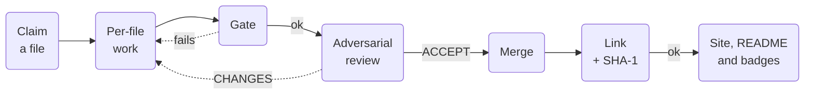

<p align="center">
  <a href="https://sh1ftmaker.github.io/fsa/">
    
  </a>
</p>

<p align="center">
  <a href="https://sh1ftmaker.github.io/fsa/"></a>
  <a href="https://sh1ftmaker.github.io/fsa/"></a>
  <a href="https://sh1ftmaker.github.io/fsa/"></a>
  <a href="https://sh1ftmaker.github.io/fsa/"></a>
  <a href="https://github.com/sh1ftmaker/fsa/actions/workflows/pages.yml"></a>
</p>

<p align="center">
  A byte-matching decompilation of <i>The Legend of Zelda: Four Swords Adventures</i> for the GameCube.
</p>

<p align="center">
  <a href="https://sh1ftmaker.github.io/fsa/"><b>Progress site</b></a>
  &nbsp;·&nbsp;
  <a href="#roadmap"><b>Roadmap</b></a>
  &nbsp;·&nbsp;
  <a href="CONTRIBUTING.md"><b>Contributing</b></a>
  &nbsp;·&nbsp;
  <a href="docs/PLAN.md"><b>Plan</b></a>
</p>

---

## About

This repository reconstructs the C and C++ source of *Four Swords Adventures*
(USA). The original Metrowerks CodeWarrior compilers build it back into a
`main.dol` that is identical, byte for byte, to the retail one. Readable,
correctly typed source with real names is part of the goal, in the style of
zeldaret/tp and KATAM.

| Property | Value |
|---|---|
| Game | The Legend of Zelda: Four Swords Adventures |
| Platform | Nintendo GameCube |
| Version | USA, `G4SE01` |
| `main.dol` SHA-1 | `d86b3d9f785566e34264035e140ef3daf3cc19f0` |
| Compilers | Metrowerks CodeWarrior GC/2.6 (game, JSystem, MSL, TRK); the SDK's own builds |
| Build system | ninja + [decomp-toolkit](https://github.com/encounter/decomp-toolkit) + [objdiff](https://github.com/encounter/objdiff) |

## Progress

<!-- progress:start -->
As of 2026-11-03: **26.91 %** of the code and **5,955 / 11,557** functions match. 420 of 902 split units are Matching, and `main.dol` built from them links byte-identically (SHA-1 OK).
<!-- progress:end -->

<picture>
  <source media="(prefers-color-scheme: dark)" srcset="site/badges/regions-dark.svg">
  <source media="(prefers-color-scheme: light)" srcset="site/badges/regions-light.svg">
  
</picture>

The whole DOL by library. Tile area is bytes of code; the fill is the share
matched. The [progress site](https://sh1ftmaker.github.io/fsa/) has the
interactive version, down to single functions.

<a href="https://sh1ftmaker.github.io/fsa/">
  
</a>

<details>
<summary>Numbers per region</summary>

<!-- regions:start -->
| Region | Code matched | Functions |
|---|--:|--:|
| Game code | 9.74 % of 3,573,784 bytes | 1,243 / 6,789 |
| JSystem | 97.8 % of 630,852 bytes | 3,649 / 3,702 |
| Dolphin SDK | 100 % of 131,224 bytes | 610 / 610 |
| GX | 100 % of 33,660 bytes | 172 / 172 |
| MSL, Runtime, TRK | 90.0 % of 72,512 bytes | 281 / 284 |
| **Whole DOL** | **26.91 %** of 4,442,032 bytes | **5,955 / 11,557** |
<!-- regions:end -->

</details>

All figures come from the honest objdiff report
(`build/G4SE01/report_honest.json`): every unit is diffed, and a function
counts only if its relocations point at the same symbols too. They are
regenerated with every merge; see [How it works](#how-it-works).

## Roadmap

<picture>
  <source media="(prefers-color-scheme: dark)" srcset="site/badges/roadmap-dark.svg">
  <source media="(prefers-color-scheme: light)" srcset="site/badges/roadmap-light.svg">
  
</picture>

<!-- now:start -->
- **Now** (phase 4): **JSystem file by file.** Per-file agents on the JSystem units still NonMatching. JSystem is at 3605 of 3706 functions; 52 are still in no split unit (gap agent running) and about 49 are left in split files, about 30 of them register-allocation or fakematch holdouts (J3DMatBlock's word copies) kept honest with FIXMEs. Weak-data and dead-data map proofs landed. Currently 86.0 % of the split files Matching.
- **Now** (phase 4): **SDK, GX and MSL link fixes.** The Dolphin SDK and GX are both 100 % and linked, GBAKey's DSP microcode extracted from the user's own main.dol at build time. Dead-stripped data is proven from the link map. Left are MSL ansi_fp/strtoul. Currently 98.9 % of the split files Matching.
- **Now** (phase 4): **THP video.** The THP player in the game region (0x80427D2C), FSA's C++ port of the SDK sample player with sms's THPDec.c and THPAudio.c inside its unit, matched against tww's d_a_movie_player. 162 of 168 functions match; the six left differ only in register order and constant-pool order. Currently 79.9 % of the code matched.
- **Now** (phase 5): **Wave 1: small files and minigames.** Small self-contained files and the mg_* minigames first. The first eight small game files are merged (all functions match; they reach Matching with the weak-dedup tooling). Currently 15.3 % of the code matched.
- **Now** (phase 5): **Wave 2: actor families.** Enemies, NPCs and objects that share a base class. Fourteen waves of six files are merged, one Sonnet agent per file and one reviewer per wave; 53 game units are Matching. Recurring shapes (square(), drawShadow(), box/position forms, empty switch cases) are in the rules card. Currently 10.2 % of the code matched.
- **Next** (phase 6): **Debug and assert strings.** OSReport output, assert and crash-debugger strings tied to the functions that print them.
<!-- now:end -->

The phases and milestones are defined in [`docs/roadmap.yml`](docs/roadmap.yml);
[`docs/PLAN.md`](docs/PLAN.md) explains the reasoning behind them.

## How it works

Each source file is worked on by one owner in its own branch and worktree.
Nothing reaches `matching` without passing the gate and an independent review,
and every merge relinks `main.dol` and checks its SHA-1.



<details>
<summary>What each step checks</summary>

- **Gate** (`tools/gate.py`): no inline asm, register binding, `#pragma` or
  `goto` the donor file doesn't have; no m2c leftovers; no field access
  through casts and offsets; no embedded bytes; no changes to measuring
  tools or report settings; `symbols.txt` only renames placeholders. Every
  unit marked `Matching` is 100 % in code and data in the honest report, and
  `main.dol` links with the original SHA-1.
- **Review** (`docs/REVIEW_BRIEF.md`): a separate reviewer that never saw the
  author's reasoning reads every changed function against the target
  assembly and the donor file, checks the data splits and the evidence for
  every new name, and returns ACCEPT, CHANGES or REJECT. Only ACCEPT merges.
- **Merge** (`tools/merge_unit.py`): squash-merges the branch, re-splits,
  runs the full `ninja` (link and SHA-1), runs the gate again and refuses if
  the honest total went down.
- **Publish**: `tools/site_data.py` writes the site data, the images in
  `site/badges/` and the numbers in this README in the same merge commit.
  CI cannot build the game (there is no disc), so GitHub Actions only
  publishes `site/` to Pages.

</details>

## Principles

- **No fakematches.** A function counts only when natural source compiles to
  the original bytes. Register pins, ordering tricks and asm stand-ins stay
  `NonMatching` with a `FIXME` saying what differs.
- **Honest measurement.** Only the honest objdiff report is quoted, and the
  linked `main.dol`'s SHA-1 is the final authority. Byte-pattern hits and
  lenient diffs never count.
- **Every submission is reviewed** adversarially before it merges.
- **AI-first, no tricks.** Most of the work is done by AI agents under the
  same gate and review as anyone else. Names need evidence: donor code, SDK
  symbols or strings in the binary.

## Building

You need your own legally obtained copy of the game. Nothing from the disc is
in this repository.

1. Install Python 3.8+ and [ninja](https://github.com/ninja-build/ninja/releases).
2. Clone the repository and extract the disc's system data so that
   `orig/sys/main.dol` exists, for example with `dtk disc extract` or
   Dolphin's *Export Partition Root*.
3. Configure and build:

   ```sh
   python3 configure.py
   ninja
   ```

The compilers, dtk, objdiff-cli and (on Linux) wibo are downloaded into
`build/` on the first run. A plain `ninja` compiles every unit, writes the
honest report, links `main.dol` and checks its SHA-1 against
`config/G4SE01/build.sha1`. On Windows the compilers run natively.

<details>
<summary>Reports, objdiff and decomp.me</summary>

```sh
ninja build/G4SE01/report_honest.json   # compile every unit and write the honest report
python3 tools/progress.py               # totals and per-library breakdown
python3 tools/fdiff.py <unit>           # per-function match of one unit
python3 tools/link_check.py             # which Matching units break the link, if the SHA-1 fails
```

[objdiff](https://github.com/encounter/objdiff/releases) reads `objdiff.json`
from the repository root; every function of the DOL can be browsed there.
Single functions can also be worked on at [decomp.me](https://decomp.me/preset/228)
with the *The Legend of Zelda: Four Swords Adventures (DOL)* preset.

</details>

## Contributing

Contributions are welcome, from people and from AI agents, under the same
rules. In short:

1. Build the project and pick a `NonMatching` file in objdiff or on the
   progress site.
2. Claim it by opening an issue, so no two people work on the same file.
3. Match it in natural C or C++ with real names and types; split its data too.
4. Run `python3 tools/gate.py` until it prints `gate: ok`, then open a pull
   request. It is reviewed before it merges.

[CONTRIBUTING.md](CONTRIBUTING.md) covers setup, claiming, code style,
verification and submission in detail; [AGENTS.md](AGENTS.md) has the same
rules as instructions for AI coding agents. Questions go to
[GitHub issues](https://github.com/sh1ftmaker/fsa/issues).

## Repository layout

| Path | Contents |
|---|---|
| `config/G4SE01/` | decomp-toolkit config: `config.yml`, `splits.txt`, `symbols.txt`, the library and game file maps |
| `libs/sdk/` | Dolphin SDK sources from doldecomp/mkdd |
| `libs/sdk_gx/` | GX from zeldaret/oot-gc |
| `libs/jsystem/` | JSystem from doldecomp/mkdd and projectPiki/pikmin2 |
| `src/` | MSL, Runtime and MetroTRK from projectPiki/pikmin2; JSystem units derived from zeldaret/tww |
| `include/` | Headers for `src/` |
| `docs/` | The plan, the roadmap, the agent and review briefs, the coordinator runbook |
| `tools/` | Build generator (from dtk-template), gate, merge and progress tools |
| `site/` | The progress site; `site/data/` and `site/badges/` are generated |

<details>
<summary>Donors and credits</summary>

Library code is imported from other decompilation projects whose licenses
allow it. Only CC0 and MIT sources are used.

| Project | Used for | License |
|---|---|---|
| [doldecomp/mkdd](https://github.com/doldecomp/mkdd) | Dolphin SDK, JSystem | CC0-1.0 |
| [zeldaret/oot-gc](https://github.com/zeldaret/oot-gc) | GX | CC0-1.0 |
| [projectPiki/pikmin2](https://github.com/projectPiki/pikmin2) | J3D, SDK leftovers, MSL_C, Runtime, MetroTRK | CC0-1.0 |
| [zeldaret/tww](https://github.com/zeldaret/tww) | JSystem headers and units | CC0-1.0 |
| [zeldaret/tp](https://github.com/zeldaret/tp) | Reference for JSystem and the SDK | CC0-1.0 |

Tools, downloaded at build time or adapted:

| Tool | License |
|---|---|
| [encounter/dtk-template](https://github.com/encounter/dtk-template) (`configure.py`, `tools/project.py`) | CC0-1.0 |
| [encounter/decomp-toolkit](https://github.com/encounter/decomp-toolkit) | MIT or Apache-2.0 |
| [encounter/objdiff](https://github.com/encounter/objdiff) | MIT or Apache-2.0 |
| [decompals/wibo](https://github.com/decompals/wibo) | MIT |
| `tools/ninja_syntax.py` from [ninja](https://github.com/ninja-build/ninja) | Apache-2.0 |

The imported directories keep their upstream `LICENSE` files.

</details>

## Legal

This is a research and preservation project. It is not affiliated with or
endorsed by Nintendo. The repository contains no game code, data or assets:
building it requires your own copy of the game. The progress site and the
images in this README are original work and publish only function names,
addresses, sizes and match results. *The Legend of Zelda* and *Four Swords
Adventures* are trademarks of Nintendo.
